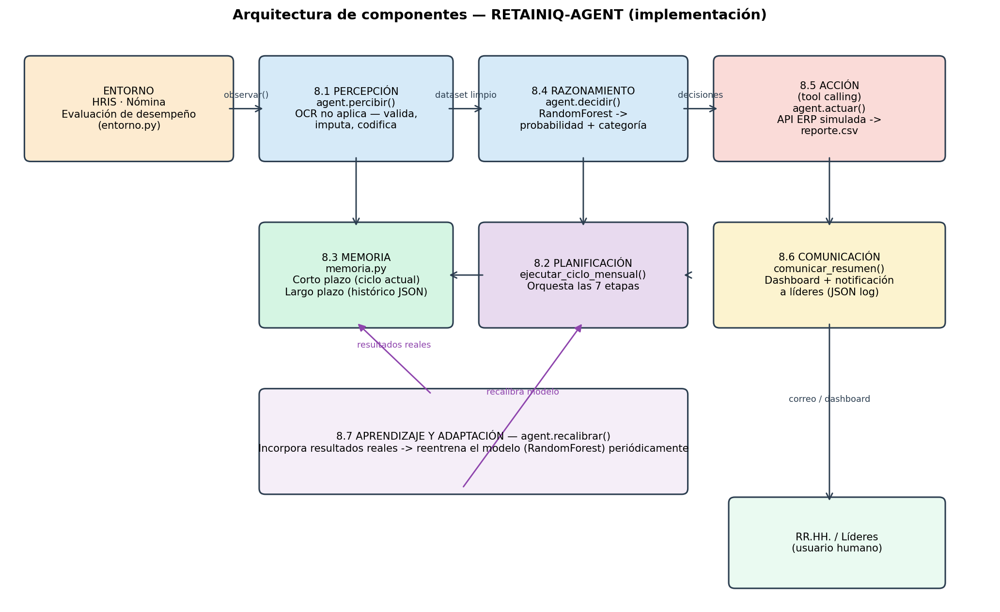
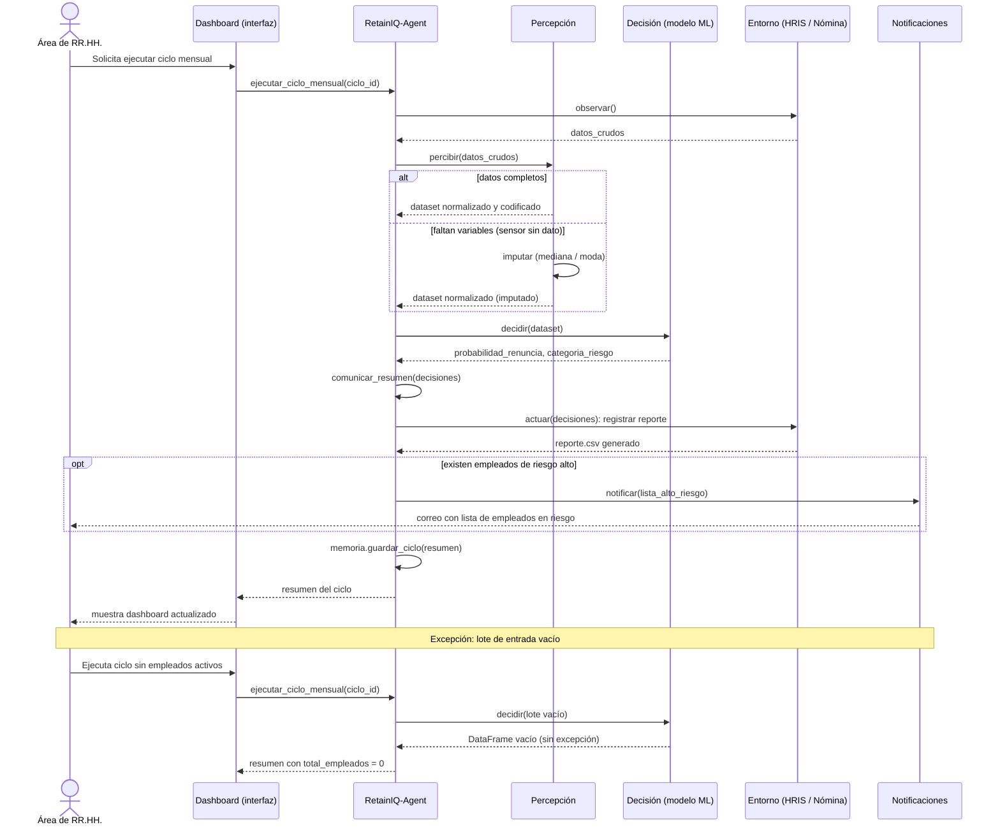

# RETAINIQ-AGENT

Agente inteligente de predicción de rotación de empleados, implementado para la actividad "Implementación del Agente Diseñado" del curso de Inteligencia Artificial de la Universidad Tecnológica de Bolívar (UTB).

- **Equipo:** David Peláez Mejía (T00079273) y Jose Pereira Acuña (T00079768)
- **Docente:** Edwin Puertas
- **Fecha de entrega:** 18 de octubre de 2026
- **Demo desplegada / video:** [PENDIENTE: pegar aquí el enlace de Streamlit Cloud o del video]

## 1. Qué es

Un agente **basado en utilidad con capacidades de aprendizaje** (clasificación de Russell y Norvig, AIMA) que, cada ciclo mensual:

1. **Percibe** los datos de los empleados (HRIS, nómina y evaluación de desempeño, simulados a partir del dataset IBM HR Analytics).
2. **Decide** la probabilidad de renuncia de cada empleado y su categoría de riesgo (alto ≥ 70 %, medio 40–70 %, bajo < 40 %) con un modelo Random Forest.
3. **Actúa**: genera un reporte y registra la notificación a los líderes por los casos de riesgo alto.
4. **Se comunica** mediante un resumen estructurado del ciclo.
5. **Recuerda**: guarda el histórico de ciclos (memoria de corto y largo plazo).
6. **Aprende**: puede recalibrar el modelo con resultados reales.

El agente no toma decisiones automáticas sobre las personas: solo apoya a RR. HH. El ciclo percepción → decisión → acción está en `agent.py`, método `ejecutar_ciclo_mensual()`.

## 2. Resultado principal 

La medida SMART del diseño era una **precisión ≥ 75 %** en la clasificación de riesgo alto. **No se cumplió.**

| Medida | Resultado (media ± σ, 5 semillas) |
|---|---|
| Precisión (umbral de decisión 0.5) | 46.2 % ± 4.5 % |
| Recall | 42.6 % ± 11.8 % |
| F1 | 43.9 % ± 8.5 % |
| AUC-ROC | 0.779 ± 0.033 |

Los valores se obtuvieron con Python 3.12, scikit-learn 1.9.1, pandas 3.0.6 y NumPy 2.5.3. Con scikit-learn 1.8 el mismo código dio una precisión de 56.7 % y un recall de 19.6 %: el conjunto de prueba es pequeño (294 registros, unas 47 renuncias), por lo que precisión, recall y F1 son inestables y el AUC-ROC es la medida más confiable. El análisis completo está en la Sección 9.7 del documento de diseño ajustado.

## 3. Estructura del repositorio

```
├── agent.py                    # Núcleo del agente (los 7 componentes de IBM)
├── entorno.py                  # Simulador del entorno (estocástico, dinámico, secuencial)
├── memoria.py                  # Memoria de corto y largo plazo
├── app.py                      # Demo interactiva (Streamlit)
├── requirements.txt            # Dependencias
├── diagrama_arquitectura.png   # Diagrama de componentes
├── diagrama_secuencia.png      # Diagrama de secuencia UML
├── diagrama_secuencia.mmd      # Diagrama de secuencia (fuente Mermaid)
├── BITACORA_IA.md              # Bitácora de uso de IA
├── data/
│   └── HR-Employee-Attrition.csv   # IBM HR Analytics (1,470 registros, 35 variables)
├── tests/
│   └── test_fase3.py           # Pruebas de la Fase 3
└── logs/                       # Evidencia de ejecución
    ├── log_ejecucion.json          # Percepciones, decisiones y acciones con marca de tiempo
    ├── memoria_largo_plazo.json    # Histórico de ciclos
    ├── reporte_ciclo_*.csv         # Reportes generados por el agente
    ├── notificacion_ciclo_*.json   # Notificaciones simuladas
    ├── resultados_fase3.csv        # Tabla de resultados de las pruebas
    └── resultados_fase3.json       # Detalle por semilla
```

## 4. Cómo ejecutarlo

Requiere Python 3.10 o superior.

**Windows (PowerShell)**

```powershell
git clone https://github.com/Davidpel31/Retainiq_agent.git
cd Retainiq_agent
python -m venv venv
venv\Scripts\Activate.ps1
pip install -r requirements.txt
python tests/test_fase3.py
streamlit run app.py
```

**Linux / macOS**

```bash
git clone https://github.com/Davidpel31/Retainiq_agent.git
cd Retainiq_agent
python3 -m venv venv
source venv/bin/activate
pip install -r requirements.txt
python3 tests/test_fase3.py
streamlit run app.py
```

Notas:
- Si Streamlit pide un correo la primera vez, déjalo vacío y presiona Enter.
- `tests/test_fase3.py` imprime la tabla de resultados y guarda `resultados_fase3.csv` y `resultados_fase3.json` en la carpeta `tests/`.
- Si ejecutan las pruebas con otras versiones de las librerías, los valores de precisión, recall y F1 pueden variar (ver Sección 2).

## 5. La demo (app.py)

La app tiene cuatro pestañas:

1. **Dashboard mensual:** ejecuta un ciclo completo sobre N empleados y muestra métricas, tabla de riesgo y gráfico.
2. **Evaluar un empleado:** probabilidad y categoría de riesgo de un empleado individual.
3. **Escenario de falla:** simula un sensor sin datos (30 % de valores faltantes en 3 variables); el agente imputa y continúa.
4. **Métricas del modelo:** métricas del entrenamiento inicial.

## 6. Pruebas (Fase 3)

`tests/test_fase3.py` convierte cada medida del diseño en una prueba con resultado numérico:

- Medida principal y complementarias (precisión, recall, F1, AUC-ROC) con 5 repeticiones, una por semilla (1 a 5).
- 2 casos límite: empleado con antigüedad máxima y empleado recién contratado.
- 2 casos de falla esperada: sensor sin dato y lote de entrada vacío.
- 1 condición excepcional: reestructuración organizacional con recorte salarial simulado.
- 1 medición de tiempo de procesamiento (la línea base de 8 minutos por empleado es una estimación, no una medición de campo).

## 7. Diagramas

**Arquitectura**



**Secuencia (ciclo típico y escenario de excepción)**



## 8. Diferencias entre diseño e implementación

- El HRIS, la nómina y el sistema de evaluación reales se sustituyeron por un simulador (`entorno.py`) construido sobre el dataset público IBM HR Analytics. Reproduce las propiedades de ambiente del diseño: parcialmente observable, estocástico, dinámico y secuencial.
- Las integraciones por API (dashboard, correo, data lake) se simularon como archivos CSV y JSON en `logs/`.
- Se implementó Random Forest; XGBoost, mencionado como alternativa en el diseño, no se implementó.
- La explicabilidad con SHAP y la detección automática de sesgos, mencionadas en el diseño, **no se implementaron**.
- Se agregó la variable derivada `RotacionPrevia = NumCompaniesWorked / (YearsAtCompany + 1)`.

Detalle completo en la Sección 9.6 del documento de diseño ajustado.

## 9. Limitaciones

- La precisión (46.2 %) está por debajo de la meta (75 %). Falta calibrar el umbral de decisión y balancear las clases.
- Las métricas de umbral son inestables con el tamaño actual del conjunto de prueba; falta validación cruzada estratificada.
- El simulador del entorno está parametrizado manualmente (ruido ±1 en satisfacción, 5 % de cambio en horas extra), sin calibrar contra datos reales.
- Sin SHAP, las predicciones no son interpretables caso por caso.
- No se evaluó sesgo algorítmico (por ejemplo, por género o departamento).

## 10. Uso de IA

Este proyecto se desarrolló con asistencia de Claude (Anthropic). El detalle de qué se hizo con IA y qué revisó el equipo está en [`BITACORA_IA.md`](BITACORA_IA.md).

## 11. Datos y referencias

- IBM HR Analytics Employee Attrition & Performance Dataset (Kaggle): https://www.kaggle.com/datasets/pavansubhasht/ibm-hr-analytics-attrition-dataset
- Russell, S. J., & Norvig, P. (2021). *Artificial Intelligence: A Modern Approach* (4th ed., Global Edition). Pearson.
- IBM. *Components of AI agents*: https://www.ibm.com/mx-es/think/topics/components-of-ai-agents
- Pedregosa, F., et al. (2011). Scikit-learn: Machine Learning in Python. *Journal of Machine Learning Research*, 12, 2825-2830.
